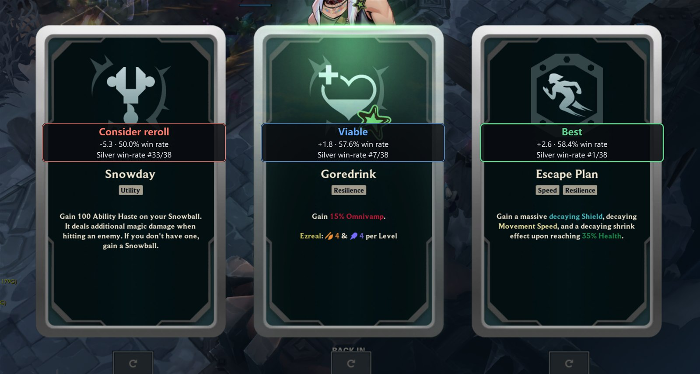
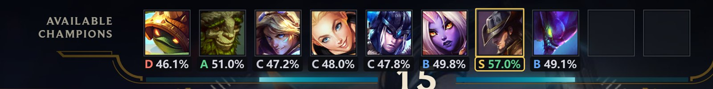

# ARAM: Mayhem Overlay

An overlay for League of Legends **ARAM: Mayhem** that answers the two questions the mode
makes you guess: *which champion should I take?* and *which of these three augments?*

It reads your screen, looks up real statistics for the current patch, and draws the answer
next to the thing you are choosing.



---

## What it does

**Champion select** — every champion in the "Available Champions" bench, plus your team's
picks, gets a letter grade, a win rate and a rank out of 173.



**Augment selection** — when the three cards appear, each one is badged with its win rate
**for the champion you are actually playing**, not a global average. The best card is
highlighted, weak cards say so, and a reroll updates the badges.

| Card | Verdict | Sample |
|---|---|---|
| Escape Plan | **Best** | 58.4% over 1,041 games |
| Goredrink | Viable | 57.6% |
| Snowday | Consider reroll | 50.0% |

The badges are click-through and disappear when the moment passes. The small AramHex icon in
the top-right corner opens the details panel. Clicking it never takes the keyboard away from
the game, and it is hidden whenever League is not the window in front.

## Using it

Start AramHex before you queue. It lives in the system tray, and its icon appears on top of
the League client and the game, then finds champion select and the augment screen by
itself. If it cannot tell which champion you are playing, click the icon and search for
your champion. Close it from the tray icon.

## Install

Two ways, same app. The installer is easier if you want a Start Menu shortcut.

**Installer** — download `AramHex-Setup-<version>.exe` from [Releases](../../releases/latest)
and run it. It installs for the current user only, so it never asks for administrator
rights, and Windows can remove it like any other program.

**Portable** — download `AramHex-Portable-<version>.zip`, unzip it somewhere permanent (not
your Downloads folder), and run `AramHex.exe`. Settings live in a `userdata` folder beside
the exe, so the whole thing moves with the folder and deleting it is the uninstall.

To upgrade a portable copy, extract the new ZIP beside the old folder, copy the old folder's
`userdata` folder into the new one, and only then delete the old folder. `userdata` holds your
settings, logs and downloaded statistics — deleting it loses all three.

To upgrade an installed copy, run the new installer. It replaces the old version and keeps
your settings.

Either way, the app ships with a recent statistics snapshot and works offline from the first
launch. When it is online it checks for newer statistics every few hours. With automatic
updates switched off in settings, it still checks, but it only offers the new statistics
and does not download them until you agree.

Windows will show **"Windows protected your PC"** on first run, because the build is not
code-signed. Click *More info* → *Run anyway*.

**Requirements:** Windows 10/11 64-bit, League set to borderless or windowed (exclusive
fullscreen cannot be overlaid), and an English client.

## How it works

It reads pixels. That is the whole trick, and it is deliberate:

- **No memory reading, no injection, no packet capture, no input synthesis.** Anti-cheat
  never has a reason to care.
- **Screen capture plus Windows' own OCR** (`Windows.Media.Ocr`, the engine already on your
  machine) reads the card titles in about **4 ms** for all three.
- The recognised name is matched against the mode's augment list, then looked up in the
  statistics for your champion.

Outbound traffic is four anonymous HTTPS hosts — the statistics pack, its fallback mirror,
and Riot's own Data Dragon and CommunityDragon asset CDNs. No account, no identifier, no
telemetry of any kind.

## Honest limitations

**The statistics are the Chinese server's.** They come from tens of millions of real Mayhem
games on seven Chinese regions, published by
[`czgreat/aramhex-data`](https://github.com/czgreat/aramhex-data); there is no comparable
public source for EUW. The app shows which patch and how many games it is using, and it
follows the newest patch as soon as the feed publishes it. Champion strength differs by
region; augment strength travels better. Everything in the app is labelled accordingly.

**New augments are picked up automatically.** When a patch adds augments, the app downloads
their English names together with the new statistics, so it can recognise them without an
app update.

**The augment screen's layout is measured against the current UI.** Sustained recognition
failure now produces one warning per game when the app can independently detect all three
card panels. This check is conservative: unknown frame colours or a major Riot redesign
can still evade it and require an update.

**It needs an English client.** Windows' OCR needs an English recogniser pack (`en-US` or
`en-GB`); the app warns you in the main window, the overlay and a tray notification if it is
missing, and turns recognition back on once you install it.

**Not affiliated with Riot Games.** Personal, non-commercial project. Riot's developer policy
does not approve published augment win-rate overlays, which is why this is a personal tool
and not a product.

## Build from source

Requires Python 3.13.

```powershell
py -3.13 -m venv .venv
.venv\Scripts\python.exe -m pip install -r requirements.txt
.venv\Scripts\python.exe -m lolhex
```

Tests:

```powershell
$env:QT_QPA_PLATFORM = 'offscreen'; .venv\Scripts\python.exe -m pytest -q
```

Packaging: `packaging/build.ps1` produces a one-folder build and a portable ZIP.

## Credits

Built on [`czgreat/aramhex`](https://github.com/czgreat/aramhex) (MIT), whose vision
pipeline, overlay layers and layout constants this fork inherits. Statistics from
[`czgreat/aramhex-data`](https://github.com/czgreat/aramhex-data) (CC BY-NC 4.0). Champion,
augment and item metadata from Riot's Data Dragon and CommunityDragon.

The fork removed upstream's telemetry, cloud configuration, self-update and Tencent data
sources, replaced RapidOCR with Windows' own engine, and localised the interface.

League of Legends and Riot Games are trademarks of Riot Games, Inc. This project is not
endorsed by or affiliated with Riot Games.
