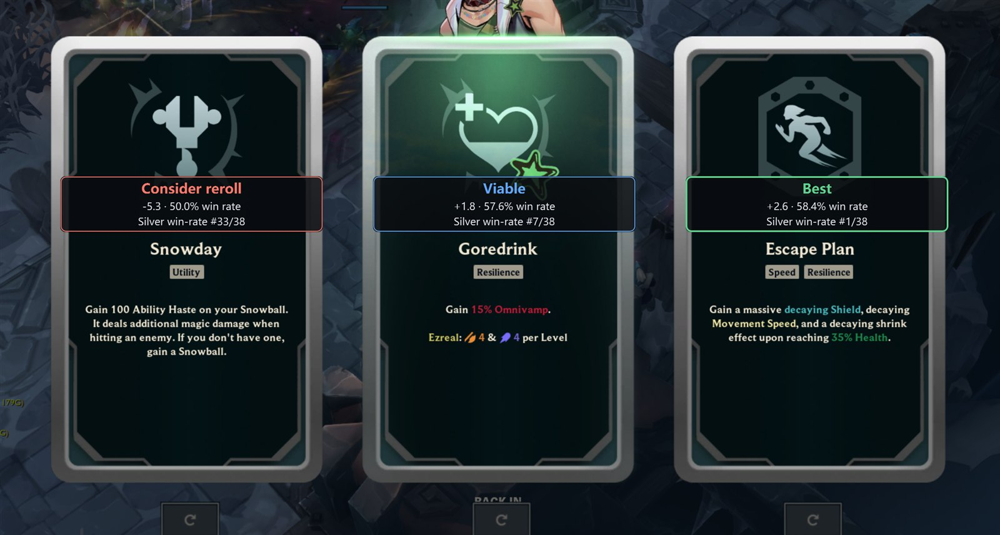
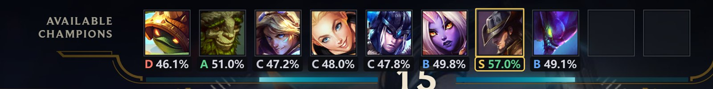

# ARAM: Mayhem Overlay

An overlay for League of Legends **ARAM: Mayhem** that answers the two questions the mode
makes you guess: *which champion should I take?* and *which of these three augments?*

It reads your screen, looks up real statistics for the current patch, and draws the answer
next to the thing you are choosing.



---

## What it does

**Champion select** — every champion in the "Available Champions" bench, plus your team's
picks, gets a letter grade, a win rate and a rank out of 173.



**Augment selection** — when the three cards appear, each one is badged with its win rate
**for the champion you are actually playing**, not a global average. The best card is
highlighted, weak cards say so, and a reroll updates the badges.

| Card | Verdict | Sample |
|---|---|---|
| Escape Plan | **Best** | 58.4% over 1,041 games |
| Goredrink | Viable | 57.6% |
| Snowday | Consider reroll | 50.0% |

The overlay never takes a click, never grabs focus, and disappears when the moment passes.

## Install

Two ways, same app. The installer is easier if you want a Start Menu shortcut.

**Installer** — download `AramHex-Setup-<version>.exe` from [Releases](../../releases/latest)
and run it. It installs for the current user only, so it never asks for administrator
rights, and Windows can remove it like any other program.

**Portable** — download `AramHex-Portable-<version>.zip`, unzip it somewhere permanent (not
your Downloads folder), and run `AramHex.exe`. Settings live in a `userdata` folder beside
the exe, so the whole thing moves with the folder and deleting it is the uninstall.

Either way, the first launch downloads the statistics (a few seconds). After that it works
offline.

Windows will show **"Windows protected your PC"** on first run, because the build is not
code-signed. Click *More info* → *Run anyway*.

**Requirements:** Windows 10/11 64-bit, League set to borderless or windowed (exclusive
fullscreen cannot be overlaid), and an English client.

## How it works

It reads pixels. That is the whole trick, and it is deliberate:

- **No memory reading, no injection, no packet capture, no input synthesis.** Anti-cheat
  never has a reason to care.
- **Screen capture plus Windows' own OCR** (`Windows.Media.Ocr`, the engine already on your
  machine) reads the card titles in about **4 ms** for all three.
- The recognised name is matched against the mode's augment list, then looked up in the
  statistics for your champion.

Outbound traffic is four anonymous HTTPS hosts — the statistics pack, its fallback mirror,
and Riot's own Data Dragon and CommunityDragon asset CDNs. No account, no identifier, no
telemetry of any kind.

## Honest limitations

**The statistics are the Chinese server's.** Riot blocks ARAM: Mayhem in their public API,
so nobody has EUW data — every site showing "Mayhem stats" is either borrowing Arena numbers
or crawling the client. The dataset here is 5.1M real Mayhem games from seven CN regions on
the live patch. Champion strength differs by region; augment strength travels better.
Everything in the app is labelled accordingly.

**The augment screen's layout is measured against the current UI.** If Riot restyles it, the
badges stop appearing. There is an open issue to make that failure visible instead of silent.

**It needs an English client.** The OCR engine needs Windows' `en-GB` recogniser pack; the
app logs a clear message if it is missing rather than silently misreading.

**Not affiliated with Riot Games.** Personal, non-commercial project. Riot's developer policy
does not approve published augment win-rate overlays, which is why this is a personal tool
and not a product.

## Build from source

Requires Python 3.13.

```powershell
py -3.13 -m venv .venv
.venv\Scripts\python.exe -m pip install -r requirements.txt
.venv\Scripts\python.exe -m lolhex
```

Tests:

```powershell
$env:QT_QPA_PLATFORM = 'offscreen'; .venv\Scripts\python.exe -m pytest -q
```

Packaging: `packaging/build.ps1` produces a one-folder build and a portable ZIP.

## Credits

Built on [`czgreat/aramhex`](https://github.com/czgreat/aramhex) (MIT), whose vision
pipeline, overlay layers and layout constants this fork inherits. Statistics from
[`czgreat/aramhex-data`](https://github.com/czgreat/aramhex-data) (CC BY-NC 4.0). Champion,
augment and item metadata from Riot's Data Dragon and CommunityDragon.

The fork removed upstream's telemetry, cloud configuration, self-update and Tencent data
sources, replaced RapidOCR with Windows' own engine, and localised the interface.

League of Legends and Riot Games are trademarks of Riot Games, Inc. This project is not
endorsed by or affiliated with Riot Games.
